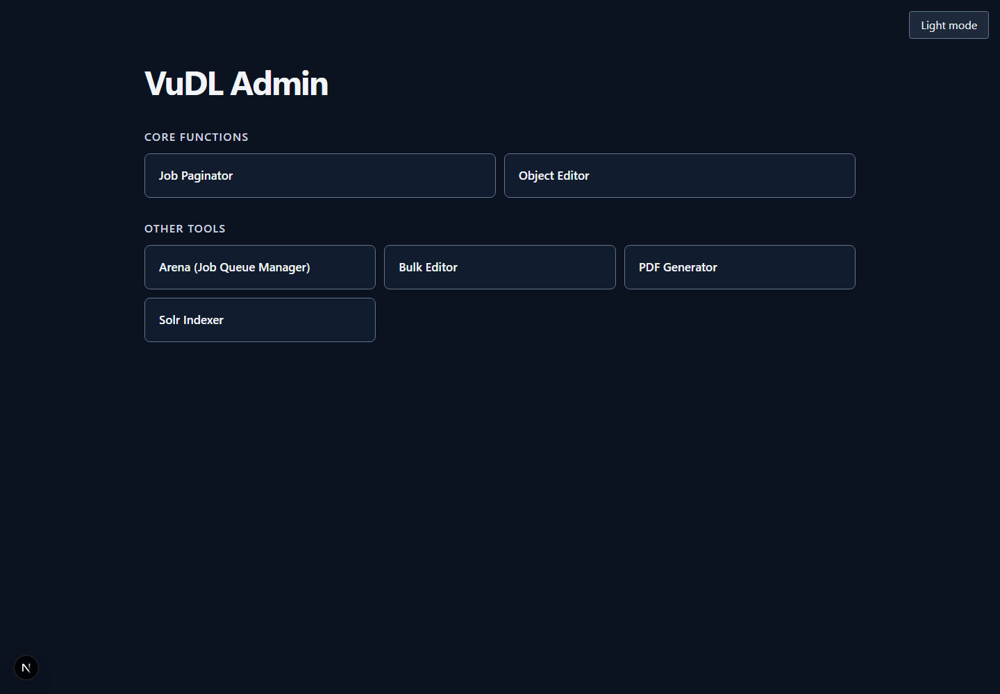
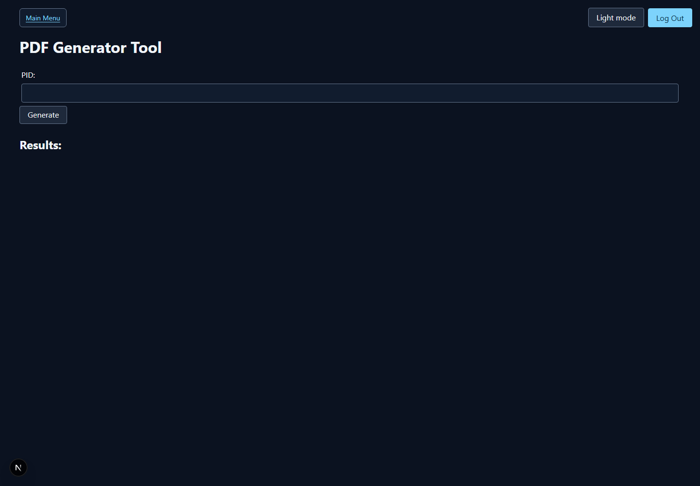
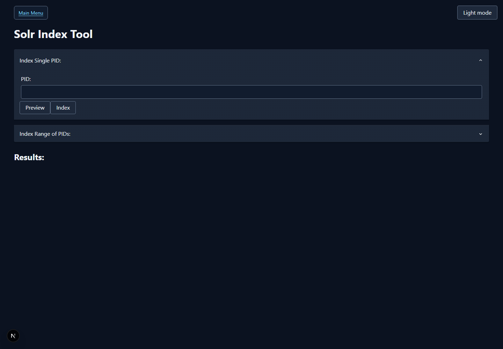

# VuDL in a box

VuDL is the ingest and management platform that powers [Villanova University's Digital Library](https://digital.library.villanova.edu/).

## About this Project

The Villanova Unviersity Digital Library is a complex project which contains many software components communicating with each other (Redis, Fedora Commons, Apache Solr, VuFind, etc.) So, I created a docker image that spins up the entire thing as a working Digital Library (and ingest system) running in a Docker virtual machine. This is primarily to help folks more easily understand how a Fedora-based Digital Library works and play around with it.

## About VuDL

See the [VuDL project](https://github.com/FalveyLibraryTechnology/VuDL) for more information. For a holistic overview of the components and their interactions in this setup, see the [system architecture guide](architecture.md).

## Main Functions

The screenshots below show the VuDL staff interface running with the local
Docker demo data. The client defaults to dark mode; use the theme toggle in the
upper-right corner to switch to light mode.

### Home dashboard

The dashboard links to the core ingest and repository tools.

### Job paginator

The paginator lists batch categories and jobs from the configured holding area.
Open a job to review its pages, set their order and labels, preview images, and
prepare the job for ingest. The current local demo holding area has no sample
batches, so this tool is not pictured.

### Object editor

The editor browses Fedora collections and objects. It supports creating
objects, managing parent/child relationships, viewing datastreams, and editing
metadata and object state.

### Bulk editor

The bulk editor selects repository records with a search query or parent PID,
then applies changes to multiple selected records.

### PDF generator

Enter an image-based Fedora object's PID to queue PDF generation from its IIIF
manifest. The worker stores the generated PDF as a child object in Fedora.

### Solr indexer

Preview or index one Fedora PID, or queue indexing for a numeric PID range.
This tool refreshes VuFind's search index after repository updates.

